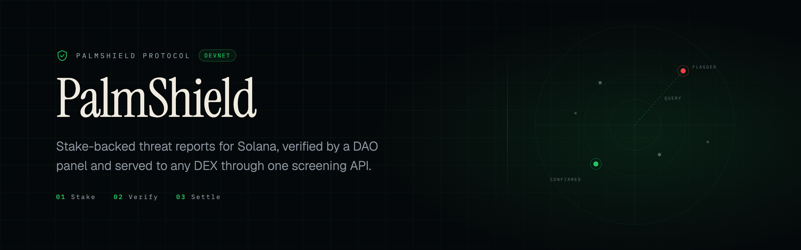
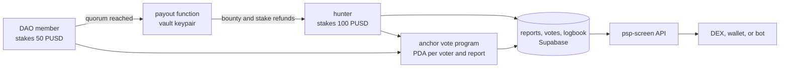
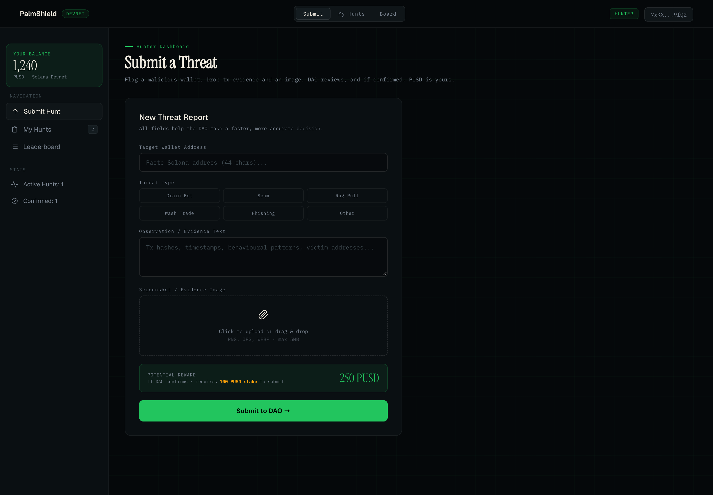
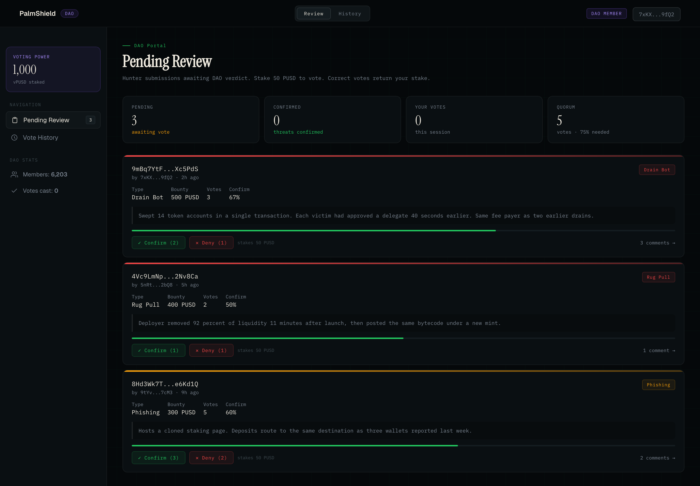
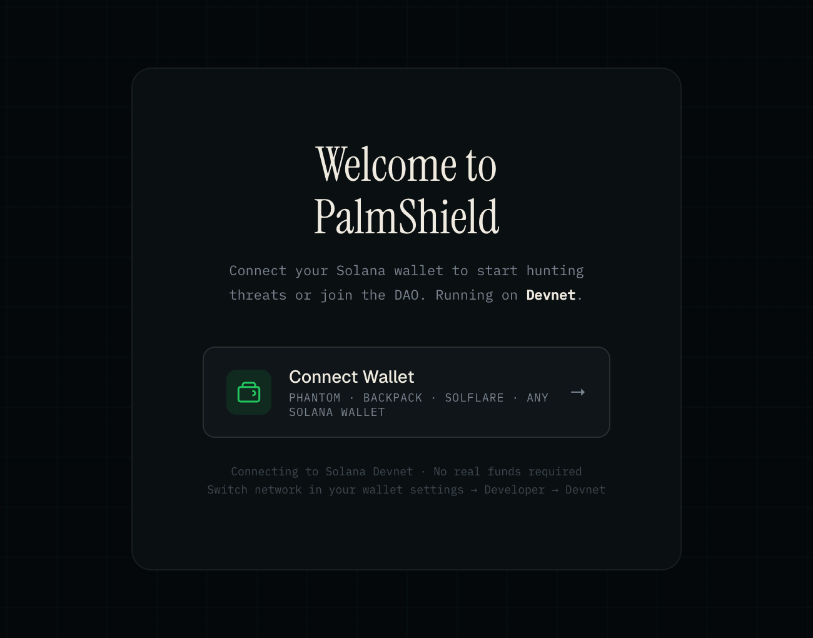

<div align="center">



<br />
<br />

<a href="LICENSE"></a>
<a href="https://solana.com"></a>
<a href="programs/palmshield/src/vote.rs"></a>
<a href="supabase/functions"></a>
<a href="SECURITY.md"></a>
<a href="https://earn.superteam.fun"></a>

<br />
<br />

**On chain threat intelligence for Solana, funded by the people who produce it.**
A researcher stakes PUSD to report a malicious wallet. A DAO panel votes on the evidence.
A confirmed report pays the researcher from a shared vault, then publishes the wallet to a
screening API that any DEX can query.

</div>

> [!WARNING]
> Devnet prototype, built for a Superteam bounty on Palm USD, placed 2nd of 98. Not audited and
> not safe to hold mainnet funds.

## Contents

- [Why this exists](#why-this-exists)
- [How it works](#how-it-works)
- [Architecture](#architecture)
- [Screens](#screens)
- [What is enforced where](#what-is-enforced-where)
- [Repository layout](#repository-layout)
- [Running the dashboard](#running-the-dashboard)
- [Configuration](#configuration)
- [Deployed addresses](#deployed-addresses-devnet)
- [Screening API](#screening-api)
- [Known gaps](#known-gaps)
- [Security](#security)
- [Contributing](#contributing)
- [License](#license)

## Why this exists

Threat reports are a public good with a private cost. The researcher who documents a drainer pays
for the time and the evidence, and every other venue gets the warning for free. PalmShield puts a
bond behind each report, has a DAO panel verify it, and turns confirmed reports into an API that a
DEX, wallet, or bot can query before it lets a wallet through.

## How it works

The protocol runs a stake, verify, payout loop.

1. **Submit.** A hunter posts a flagged wallet with transaction evidence and an image, and stakes
   100 PUSD. The stake is the honesty bond: a wrong call costs money.
2. **Vote.** A DAO member stakes 50 PUSD and casts a vote on chain. Each vote is its own program
   derived account, seeded by voter and submission id, so one wallet cannot vote twice on the same
   report.
3. **Settle.** Once confirmed votes pass quorum, the vault refunds the hunter stake, pays the
   bounty, refunds voter stakes, and the report is written to the logbook.

A confirmed report becomes queryable through the screening function, which scores a wallet between
0 and 0.99 from confirmed report count, total flags, and threat type.

## Architecture



The dashboard talks to Supabase directly with the anon key. The vote program is the only part that
runs on chain, and the payout function is the only part that can move PUSD out of the vault.

## Screens

Screenshots use sample reports and demo statistics so the empty states are not the whole story.

| Hunter dashboard | DAO review queue |
| :---: | :---: |
|  |  |

<p align="center">
  
</p>

## What is enforced where

This table is the honest version of the architecture, so read it before the feature list.

| Rule | Enforced by | Notes |
| --- | --- | --- |
| One vote per wallet per submission | On chain | PDA seeded by voter and submission id |
| Stake before voting | Client | `palmshield/js/dao.js` transfers before writing the vote row |
| Quorum | Client | Counted in the browser, see Known gaps |
| Payout amounts | Edge function | Vault keypair from `VAULT_SECRET_KEY_B58` |
| Read access to reports | Database | Open |

## Repository layout

```text
programs/palmshield/src/vote.rs     on chain vote program (Anchor)
supabase/functions/psp-screen/      wallet screening API, public and read only
supabase/functions/payout/          vault payouts and stake refunds
db/schema.sql                       tables, indexes and row level security policies
palmshield/                         dashboard, static HTML with no build step
  index.html
  css/styling.css
  js/                               config, state, wallet, hunter, dao, render
docs/assets/                        banner and dashboard screenshots
scripts/check-repo.mjs              repository checks used by CI
.github/workflows/check.yml         runs those checks on pushes and pull requests
```

## Running the dashboard

Requirements: Python 3 (or any static file server), a browser, and a Solana wallet extension set
to devnet. There is no bundler and no dependency install. Serve the folder over HTTP, since the
Solana libraries come from a CDN:

```bash
git clone https://github.com/maxxexee/palm-shield.git
cd palm-shield/palmshield
python3 -m http.server 8080
```

Open http://localhost:8080 and connect a Phantom wallet set to devnet.

Set `SUPABASE_ANON` in `palmshield/js/config.js` first, otherwise the dashboard loads but cannot
read or write reports.

## Configuration

| What | Where |
| --- | --- |
| Supabase URL and anon key, vault address, PUSD mint, program id, stake and quorum parameters | `palmshield/js/config.js` |
| Vault keypair for payouts | Supabase secret `VAULT_SECRET_KEY_B58` |
| Tables and policies | `db/schema.sql`, run once against a fresh Supabase project |

The anon key is public by design. Row level security is what protects the data, and it is
currently permissive on purpose for the demo. See Known gaps.

## Deployed addresses (devnet)

| Item | Address |
| --- | --- |
| Vote program | [`AcksH6RgonJwV52Zd59GmxdXUJAMvdU1B3mq8BAEu3bm`](https://explorer.solana.com/address/AcksH6RgonJwV52Zd59GmxdXUJAMvdU1B3mq8BAEu3bm?cluster=devnet) |
| PUSD mint | [`8jMZDTVvVFMGikt78Fpp9W9aTG4z9CP51VbCR85Xd3pQ`](https://explorer.solana.com/address/8jMZDTVvVFMGikt78Fpp9W9aTG4z9CP51VbCR85Xd3pQ?cluster=devnet) |
| Vault | [`6bSGwGnYN18D2etp84YQcRy3F7UgNWyEJPeAdLgwz1rj`](https://explorer.solana.com/address/6bSGwGnYN18D2etp84YQcRy3F7UgNWyEJPeAdLgwz1rj?cluster=devnet) |

## Screening API

```bash
curl "https://iffyvycwlhgnsqotlckv.supabase.co/functions/v1/psp-screen?wallet=<pubkey>&format=json"
```

Response fields: `risk` (0 to 0.99), `riskLevel` (`LOW`, `MEDIUM`, `HIGH`, `CRITICAL`), `tags`,
`totalFlags`, `confirmedFlags`.

```json
{
  "wallet": "<pubkey>",
  "shortWallet": "8jMZDTV...Xd3pQ",
  "chain": "solana",
  "network": "devnet",
  "risk": 0.99,
  "riskLevel": "CRITICAL",
  "tags": ["drain-bot", "confirmed", "flagged-3x"],
  "totalFlags": 3,
  "confirmedFlags": 1
}
```

Without `format=json` the same function answers in plain text for terminals and agent tooling:

```text
psp screen 8jMZDTV...Xd3pQ
chain:
solana
risk:
0.99 · CRITICAL
tags: drain-bot, confirmed, flagged-3x
```

Without a `wallet` parameter the function returns the whole logbook, newest first, capped at 100
rows, grouped by wallet and sorted by risk.

Scoring is transparent rather than clever. A confirmed report adds 0.55, two or more flags add
0.2, three or more add 0.15, a drainer or rug pull adds 0.15, and a pending flag adds 0.05. The
total is capped at 0.99.

## Known gaps

Listed because a security repo that hides its own weak points is worth less than one that names
them.

1. **The payout function is unauthenticated.** `supabase/functions/payout/index.ts` accepts a POST
   with a hunter wallet, voter wallets and a bounty, then signs transfers from the vault keypair.
   There is no auth check, and the caller is the browser, so a shared secret in the client would
   not help. The correct fix is to move quorum evaluation and payout into a server function that
   reads the vote rows itself and verifies them.
2. **Quorum is client side.** `palmshield/js/dao.js` counts votes and decides when to pay, so the
   payout trigger is a suggestion rather than an enforcement.
3. **Votes and payouts accept writes from any anon client.** The policies in `db/schema.sql` are
   `true` for select and insert by design for the demo. That is fine on devnet with play money and
   wrong the moment a vault holds anything real.
4. **The program cannot be built from this repo.** No `Anchor.toml` and no `Cargo.toml` are
   committed. `programs/palmshield/src/vote.rs` is the source of what is deployed, kept here for
   reading.
5. **Vote account space is under allocated.** `space = 8 + 32 + 64 + 8 + 8` gives 120 bytes, but
   two Strings of up to 64 bytes need 4 bytes of length prefix each, so the account needs about
   184. Initialisation will fail for long submission ids.
6. **No tests.** CI runs `scripts/check-repo.mjs`, which covers local asset references, JavaScript
   syntax, README links and a few security invariants. That is hygiene, not coverage: there are no
   unit tests for scoring, the vote program, or the payout path.
7. **The live URL is the landing page, not the dashboard.** The dashboard is the `palmshield/`
   folder in this repo.

## Security

Read [SECURITY.md](SECURITY.md). Report vulnerabilities through the repository Security tab, not
a public issue.

## Contributing

Read [CONTRIBUTING.md](CONTRIBUTING.md). The known gaps above are the highest value work, and
`node scripts/check-repo.mjs` is the same check CI runs.

## License

MIT, see [LICENSE](LICENSE).
